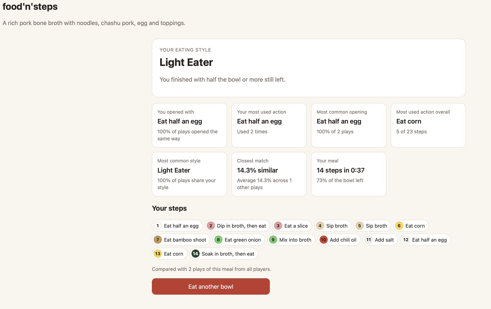
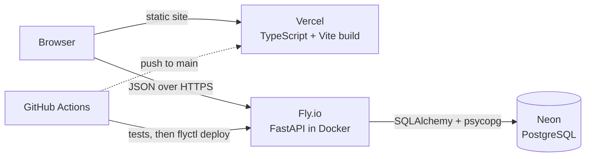

<div align="center">

# food'n'steps

**Pick a meal (tonkotsu ramen or a burger with fries and a drink), eat it one action at a time, then see how your eating style compares with every other player.**

[](https://github.com/joshuah04/foodnsteps/actions/workflows/ci.yml)


[](LICENSE)

[Play it](https://foodnsteps-api.fly.dev) · [API docs](https://foodnsteps-api.fly.dev/docs) · [Design plan](PLAN.md)



</div>

## Overview

food'n'steps serves you a bowl of tonkotsu ramen drawn as an interactive graphic. Every ingredient is clickable, every action (slurp the noodles, dip the chashu, add chili oil, stir) is recorded as a step, and you decide when you are done. When you finish, the server compares your full sequence of steps with every other play of the same meal.

## Features

* **Action based gameplay.** Each ingredient offers only the actions that make sense for it, with rules for how actions interact (stirring spreads toppings into the broth, the bowl can only be drunk once the noodles are low).
* **Eating style detection.** Each play is labeled with one of eight styles, such as Noodle Rusher, Broth Taster, Saves the Best for Last or Light Eater.
* **Crowd comparison.** See the most common opening move, the most used action overall, and how many players share your style.
* **Sequence similarity.** Your step sequence is scored against every other play using Levenshtein edit distance, giving your closest match and average similarity.
* **Anonymous by design.** No accounts and no personal data, just the steps.

## Architecture



| Layer | Technology | Hosted on |
| --- | --- | --- |
| Frontend | TypeScript, Vite, plain DOM and SVG (no framework) | Vercel |
| API | Python 3.12, FastAPI, Pydantic, SQLAlchemy 2 | Fly.io (Docker) |
| Database | PostgreSQL (SQLite for local development) | Neon |
| CI/CD | GitHub Actions: pytest against Postgres, type check, Vitest, build, deploy | GitHub |

The `Dockerfile` also bundles the built frontend into the API image, so the whole app can run as a single service (used by `render.yaml` and the Fly url).

## Quick start

Requires Python 3.11+ and Node.js 20+.

```bash
# API on http://localhost:8000
cd backend
python3 -m venv .venv && source .venv/bin/activate
pip install -r requirements.txt
python -m app.seed --count 300   # optional sample ramen plays
python -m app.seed --count 300 --meal burger   # and burger plays
uvicorn app.main:app --reload
```

```bash
# Game on http://localhost:5173 (forwards /api to port 8000)
cd frontend
npm install
npm run dev
```

The API uses a local SQLite file unless `DATABASE_URL` points at PostgreSQL.

## Configuration

| Variable | Where | Purpose | Default |
| --- | --- | --- | --- |
| `DATABASE_URL` | API | Database connection string | `sqlite:///./foodnsteps.db` |
| `CORS_ORIGINS` | API | Comma separated sites allowed to call the API | `http://localhost:5173` |
| `CORS_ORIGIN_REGEX` | API | Optional pattern of allowed sites, such as Vercel previews | none |
| `COMPARE_LIMIT` | API | How many recent plays each result compares against | `1000` |
| `STATIC_DIR` | API | Folder of built frontend files to serve | set in the Docker image |
| `VITE_API_URL` | Frontend (build time) | Base url of the API | same origin |

## Testing

```bash
cd backend && pip install -r requirements-dev.txt && pytest
cd frontend && npm test && npm run typecheck
```

CI runs the backend suite against a real PostgreSQL 16 service container, plus the frontend type check, unit tests and production build, on every push and pull request.

## Deployment

| Part | Service | Config |
| --- | --- | --- |
| Game | Vercel, root directory `frontend` | `frontend/vercel.json`, env `VITE_API_URL` |
| API | Fly.io, region `iad` | `fly.toml`, secret `DATABASE_URL`, env `CORS_ORIGINS` |
| Database | Neon, AWS us-east-1 | connection string only |

* **Vercel** builds and deploys the game on every push to `main`, with a preview url for each pull request.
* **Fly.io** is deployed by the `deploy-api` CI job after all tests pass on `main` (needs the `FLY_API_TOKEN` repository secret). Manual deploy: `fly deploy`.
* **Seeding** a fresh database: `fly ssh console -C "python -m app.seed --count 300"`.
* **Alternative:** `render.yaml` deploys the single service image plus a database to Render as a Blueprint.

<details>
<summary>First time setup, step by step</summary>

1. **Neon:** create a project in AWS US East 1 and copy its connection string.
2. **Fly.io:**
   ```bash
   fly auth login
   fly apps create foodnsteps-api          # names are global; update fly.toml if taken
   fly secrets set DATABASE_URL='postgresql://...'
   fly deploy
   fly scale count 1 --yes                 # one machine is enough for a demo
   ```
3. **Vercel:** import the repo, set Root Directory to `frontend`, add `VITE_API_URL=https://foodnsteps-api.fly.dev`, deploy.
4. **CORS:** if the Vercel url differs from `fly.toml`, run `fly secrets set CORS_ORIGINS=https://your-app.vercel.app`.

</details>

## API

| Method | Path | Description |
| --- | --- | --- |
| `GET` | `/api/health` | Health check used by Fly |
| `POST` | `/api/sessions` | Save a finished play with all of its steps; returns its id |
| `GET` | `/api/sessions/{id}/results` | Compare that play with every play of the same meal |

Interactive OpenAPI docs are served at `/docs`.

## Project structure

```
foodnsteps/
├── frontend/
│   ├── src/
│   │   ├── meals/           # one file per meal: amounts, positions and actions (tune the game here)
│   │   ├── rules.ts         # pure game rules, no DOM
│   │   ├── analysis.ts      # eating style rules and stats, no DOM
│   │   ├── game.ts          # drawing, action menu, animations, step log
│   │   ├── results.ts       # results screen
│   │   └── api.ts           # backend client
│   ├── tests/               # Vitest
│   └── vercel.json
├── backend/
│   ├── app/
│   │   ├── main.py          # routes and CORS
│   │   ├── models.py        # plays and steps tables
│   │   ├── compare.py       # Levenshtein similarity and aggregate stats
│   │   ├── db.py            # engine and sessions
│   │   └── seed.py          # simulated players
│   └── tests/               # pytest
├── Dockerfile               # multi stage: build frontend, then run API
├── fly.toml
├── render.yaml
└── .github/workflows/ci.yml
```

## Roadmap

- [x] Ramen prototype with eating styles
- [x] Meal picker with a burger, fries and drink meal, stats compared per meal
- [x] Shared backend with crowd comparison and sequence similarity
- [x] CI with PostgreSQL, Docker image, split deploy on Vercel, Fly.io and Neon
- [ ] Error monitoring and structured logs
- [ ] Database migrations with Alembic
- [ ] Daily meal with per day stats, meals served from the API
- [ ] Precomputed aggregates and load testing
- [ ] Popular paths and player clustering
- [ ] End to end tests with Playwright

See [PLAN.md](PLAN.md) for the full design.

## License

[MIT](LICENSE)
